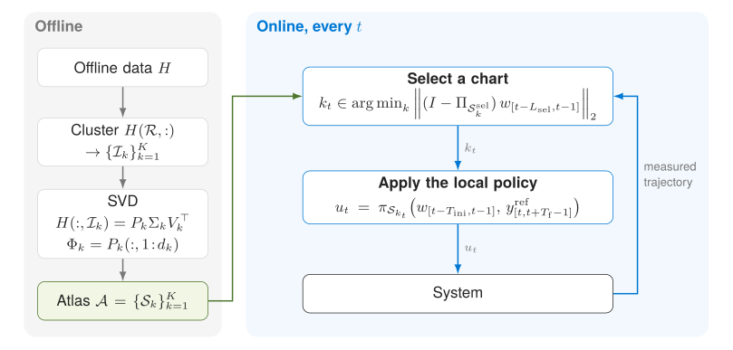

# Atlas-DeePC: Learning Behavioral Atlases for Predictive Control

**Dian Jin, Zhiyuan Jin, Jeremy Coulson**

[**Project page**](https://dianjin-frederick.github.io/Atlas-DeePC/) · [**Paper**](https://dianjin-frederick.github.io/Atlas-DeePC/paper/AtlasDeePC_manuscript.pdf)

<p align="center">
  
</p>

Data-enabled Predictive Control (DeePC) predicts with linear combinations of
recorded input-output trajectories. For nonlinear systems, a single subspace of
trajectories is only locally accurate, and the optimization grows with the
dataset. **Atlas-DeePC** clusters the offline trajectories and fits a
low-dimensional subspace, a *behavioral chart*, to each cluster. Online, it
selects the chart that best explains the most recent measurements and solves a
DeePC problem whose size depends on the chart rank, not on the dataset size. A
graph over the charts supplies intermediate references when the target lies in
a different operating region.

This repository contains the controller, the two benchmarks from the paper
(a MuJoCo two-link **Reacher** and **F1TENTH** autonomous racing), the
comparison methods, and the notebooks that produce the paper's results.

## Results at a glance

Reacher, 500 test simulations (seeds 10001–10500), output dimension p = 8:

| Method | Success rate | Median computation per step |
|---|---|---|
| Atlas-DeePC, no guidance (K = 64, d = 53) | 90.0% | 20 ms |
| Atlas-DeePC, graph guidance (K = 96, d = 57) | 94.2% | 20 ms |
| Select-DPC | 83.0% | 1331 ms |
| Contextual-DPC | 84.0% | 80 ms |

With the orientation of the second link added to the output (p = 10, K = 64,
d = 62, graph guidance), the success rate is 98.8%. Timings are on an Apple M1
Pro CPU. See the paper for error percentiles, the F1TENTH results, and the
ablations.

## Repository layout

| Folder | Contents |
|---|---|
| `src/atlas_deepc/` | Atlas-DeePC: atlas construction, chart selection, graph guidance, controller, task utilities, experiment runners ([code map](src/README.md)) |
| `src/comparison_methods/` | Contextual-DPC, KDE-BDPC and adapters for the external Select-DPC code |
| `notebooks/` | Paper experiments, comparisons and ablations ([index](notebooks/README.md)) |
| `data/` | Offline datasets: Reacher Hankel data and F1TENTH data at each noise level, plus the track map |
| `scripts/` | Command-line runners (F1TENTH paper runs, Select-DPC setup) and maintenance tools |
| `configs/` | Frozen tuning records and dependency locks |
| `docs/` | Reproduction protocols ([F1TENTH](docs/f1tenth/README.md)) |
| `third_party/` | F1TENTH simulator (MIT license) |
| `experiments/` | Result folders written by the runners (saved results are not included; see below) |

## Installation

The code was developed and tested with Python 3.10 on macOS (Apple Silicon).

```sh
python3.10 -m venv .venv
source .venv/bin/activate
pip install -r requirements-control-parameter.txt   # core: NumPy, CVXPY, Clarabel, MuJoCo/Gymnasium, scikit-learn, Jupyter
pip install -r requirements-f1tenth.txt             # only for the F1TENTH example
```

The F1TENTH simulator is vendored in `third_party/f1tenth_gym` and found
automatically. Notebooks add `src/` to the import path; for scripts, run from
the repository root with `PYTHONPATH=src`.

## Getting started

Run everything from the repository root.

**Reacher.** Open the
[main Reacher notebook](notebooks/reacher/baselines/baseline_graph_routed_atlas_deepc.ipynb).
It builds the atlas from `data/reacher/select_iid_offline_hankel.npy` and
evaluates the four paper configurations (p = 8 or 10, with or without graph
guidance). Each notebook has run switches at the top; they default to reading
saved results, so enable them before using Run All to launch new rollouts.

**F1TENTH.** Open the
[F1TENTH notebook](notebooks/f1tenth/baselines/baseline_f1tenth_atlas_deepc.ipynb),
or rerun the frozen paper configurations from the command line:

```sh
PYTHONPATH=src OPENBLAS_NUM_THREADS=1 OMP_NUM_THREADS=1 \
  python scripts/run_f1tenth_paper.py --output experiments/f1tenth/paper_nsr_rerun
```

The [F1TENTH protocol](docs/f1tenth/README.md) documents the noise model,
tuning, success criterion and timing.

**Comparisons and ablations.** The [notebook index](notebooks/README.md) lists
the Contextual-DPC, KDE-BDPC and Select-DPC comparisons, the chart-count and
rank ablation, and the graph-guidance study.

## Reproducing the paper results

- **Included:** the offline datasets in `data/`, all controller and runner code,
  and the notebooks.
- **Not included:** saved rollouts, videos and summaries under `experiments/`.
  They are large and are regenerated by the runners. Cells that only read saved
  results will report missing files until the corresponding experiment has been
  run.
  <!-- TODO: if results are archived (e.g. Zenodo), link them here. -->
- Each runner writes to its own result folder and records hashes of the source,
  data and protocol. Use a fresh folder for new runs; a folder created with
  different code or settings is rejected rather than mixed.
- Keep timing runs serial (one experiment at a time) to reproduce the reported
  computation times; absolute times depend on the hardware.

## Optional: Select-DPC comparison

Select-DPC is an external method, not part of Atlas-DeePC. The setup script
downloads the authors' code from
[choose-wisely-paper](https://github.com/naefjo/choose-wisely-paper) at commit
`8afa3b36ca47570400b0b8ff82328ab25ee3fdee` (keeping its license) into a
separate virtual environment. Setup does not launch any experiment.

```sh
python3.10 scripts/setup_select_dpc.py           # install
python3.10 scripts/setup_select_dpc.py --check   # verify
python3.10 scripts/run_select_dpc.py --help      # seeds, steps, output folder; add --our-data for the Atlas dataset
```

The default location is `~/.local/share/atlas-deepc/select-dpc/`; set
`ATLAS_DEEPC_SELECT_DPC_HOME` before setup (and before starting a notebook
kernel) to use another one. Create the environment at its final location rather
than moving it.

The comparison notebooks are
[Select-DPC with the original data](notebooks/reacher/comparisons/select_dpc_original.ipynb)
and [Select-DPC with the Atlas data](notebooks/reacher/comparisons/select_dpc_our_data_development.ipynb).
Both default to `RUN_EXPERIMENT = False`; reading saved reports needs only the
usual NumPy/pandas/Matplotlib environment. For a new run, choose a fresh
`RESULT_DIR`, enable `RUN_EXPERIMENT` and set the batch size.

`configs/select_dpc_macos_arm64_py310.lock` pins the full dependency set for the
validated Apple Silicon / Python 3.10 environment; other platforms use
`requirements-select-dpc.txt` and need their own validation. Our solver and
logging changes live in the comparison adapters; the upstream source is not
edited.

## License

<!-- TODO: add a LICENSE file for this repository (e.g. MIT or BSD-3-Clause) and name it here. -->
The vendored F1TENTH simulator in `third_party/f1tenth_gym` is under the MIT
license (see its `LICENSE`). Select-DPC, when installed, keeps its authors'
license.

## Citation

```bibtex
@article{jin2026atlasdeepc,
  title  = {Atlas-DeePC: Learning Behavioral Atlases for Predictive Control},
  author = {Jin, Dian and Jin, Zhiyuan and Coulson, Jeremy},
  year   = {2026}
}
```

<details>
<summary>Notes for the authors' local setup</summary>

On the authors' machine, many saved arrays, videos, JSON summaries and protocol
files in `experiments/` are links to an external drive
(`/Volumes/Crucial X10/atlas_deepc_data/`) through `.external_experiment_data`
(ignored by Git). Connect that drive before reading linked results. Original
offline inputs and the notebooks/code stay on the computer, and new outputs are
written locally unless a runner explicitly uses the drive.

The local historical archive and obsolete cleanup/migration records have been
removed; this did not delete targets on the drive or change retained results.
Historical source snapshots inside retained experiment folders remain part of
those experiments' provenance. Keep a separate backup of important data.

Source/data/protocol hashes protect saved runs. Changed implementations must use
a fresh result directory and must not overwrite the provenance of earlier runs.
Existing Select-DPC result directories keep their frozen source hashes; moving
the adapter does not permit mixing new runs into old protocols. Setup records
resolved package artifacts in the external `pip-install-report.json`.
</details>
