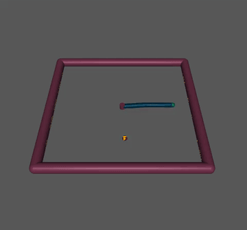
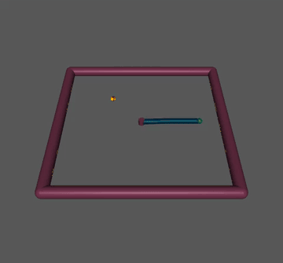
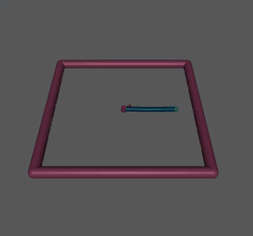
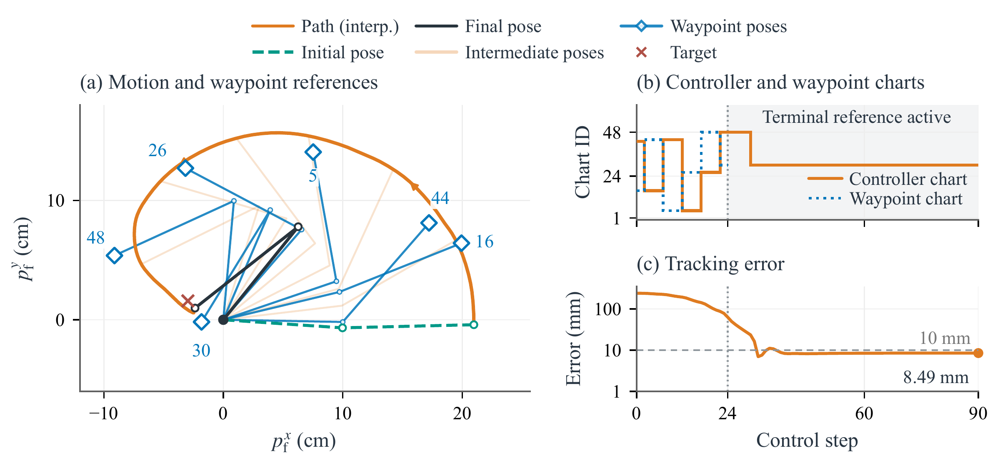
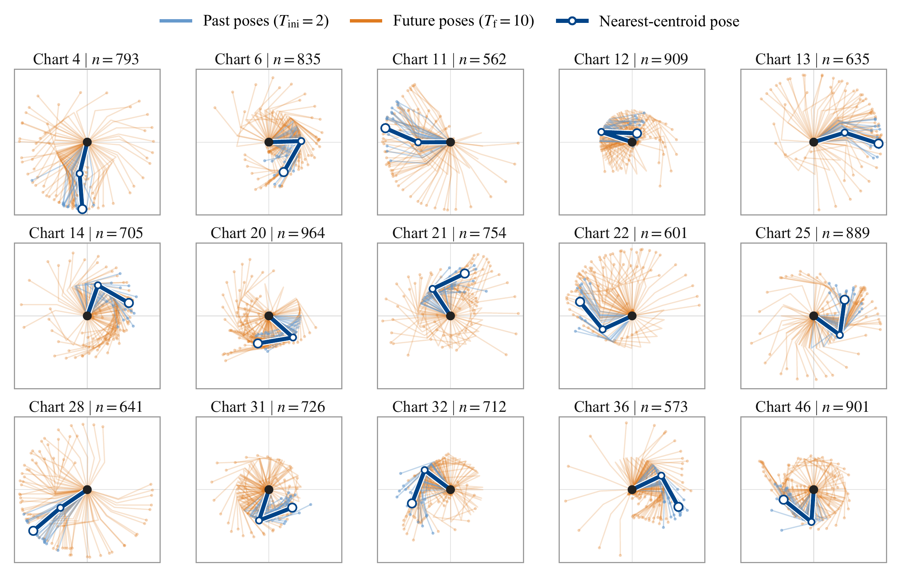

# Atlas-DeePC

## Site settings

- **Browser title:** Atlas-DeePC
- **Paper title:** Atlas-DeePC: Learning Behavioral Atlases for Graph-Guided Predictive Control
- **Menu button:** Menu

## Navigation

- [Atlas-DeePC](#atlas-deepc)
  - [Site settings](#site-settings)
  - [Navigation](#navigation)
  - [Overview](#overview)
  - [Abstract](#abstract)
  - [Demonstrations](#demonstrations)
  - [Algorithm](#algorithm)
  - [Ablation studies](#ablation-studies)
  - [Comparisons](#comparisons)
  - [Resources](#resources)

## Overview

Atlas-DeePC uses a behavioral atlas and graph-guided waypoint references for predictive control. This Reacher example shows the arm moving toward its target, the selected controller and waypoint charts, and the tracking error, which ends at 8.49 mm in this rollout.

The behavioral atlas in physical space. Fifteen charts are shown through their past and future robot poses; the highlighted pose in each chart is the nearest-centroid representative.

## Abstract
Atlas-DeePC is a data-enabled predictive control framework that turns offline trajectories into a behavioral atlas for goal-directed control. Rather than describing nonlinear behavior with a single global linear representation, it learns a collection of local linear subspaces and selects the appropriate one from current measurements. These representations are used directly to predict future behavior and optimize control actions, without first identifying an explicit dynamics model. To reach distant goals, Atlas-DeePC connects local behaviors through a graph of transitions observed in the data. The graph supplies intermediate references that adapt as the system moves, guiding local predictive control toward the target. On the Reacher task, Atlas-DeePC achieves up to 96.5% success over 1,000 initial-condition and target pairs, illustrating how local behavioral representations and graph-guided reference generation work together to enable effective control.

## Demonstrations

## Algorithm

## Ablation studies

## Comparisons

## Resources
